<div align="center">

  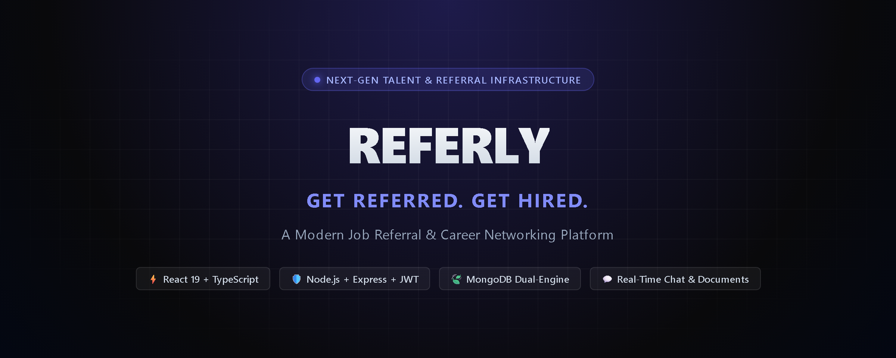

  <br />
  <br />

  [](https://github.com/ABHI180-hash/referly-job-referral-platform)
  [](LICENSE)
  [](https://react.dev/)
  [](https://www.typescriptlang.org/)
  [](https://nodejs.org/)
  [](https://expressjs.com/)
  [](https://www.mongodb.com/)
  [](https://tailwindcss.com/)

  <br />

  <p align="center">
    <strong>A full-stack job referral and career networking platform connecting talented candidates directly with verified employee sponsors at top tech companies.</strong>
  </p>

  <p align="center">
    <a href="#-project-overview">Overview</a> •
    <a href="#-application-screenshots">Screenshots</a> •
    <a href="#-key-features">Key Features</a> •
    <a href="#-system-architecture">Architecture</a> •
    <a href="#-tech-stack">Tech Stack</a> •
    <a href="#-installation--setup">Installation</a> •
    <a href="#-api-documentation">API Docs</a> •
    <a href="#-license">License</a>
  </p>

</div>

---

## 📌 Project Overview

**Referly** solves the fundamental flaw of the modern hiring landscape: **the ATS black hole**. 

Traditional online applications regularly yield sub-2% response rates as hundreds of resumes flood automated parsers. Meanwhile, internal employee referrals account for over 40% of all hires and accelerate time-to-hire by 55%. Despite this, securing a referral has historically depended on fragmented LinkedIn cold DMs, awkward personal favors, and unstructured email chains.

Referly formalizes the employee referral process into an intuitive, role-governed career marketplace:
- **For Job Seekers:** Discover 26+ curated engineering requisitions across top tech firms (Stripe, Linear, Vercel, Figma, Google, Uber, Razorpay), connect with verified internal sponsors, submit targeted referral pitches with resume attachments, and track application pipelines in real-time.
- **For Referrers:** Showcase your corporate affiliation with verified badges, review qualified candidate pitches and resumes in a centralized inbound inbox, accept or decline requests with actionable feedback, and chat directly with candidates.
- **For Administrators:** Oversee platform telemetry, curate requisitions and corporate profiles, maintain trust and safety, and monitor system metrics through a dedicated Mission Control dashboard.

---

## 📸 Application Screenshots

### Public Experience & Opportunity Discovery

| Homepage / Landing View | Curated Jobs Directory |
| :---: | :---: |
| 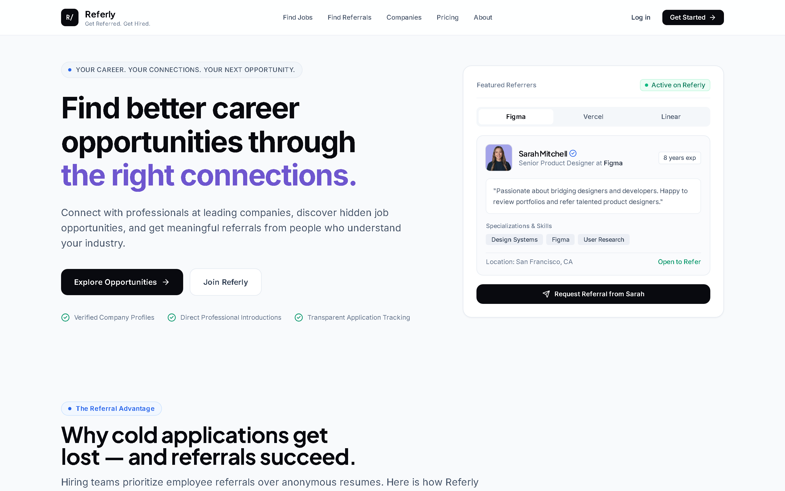 | 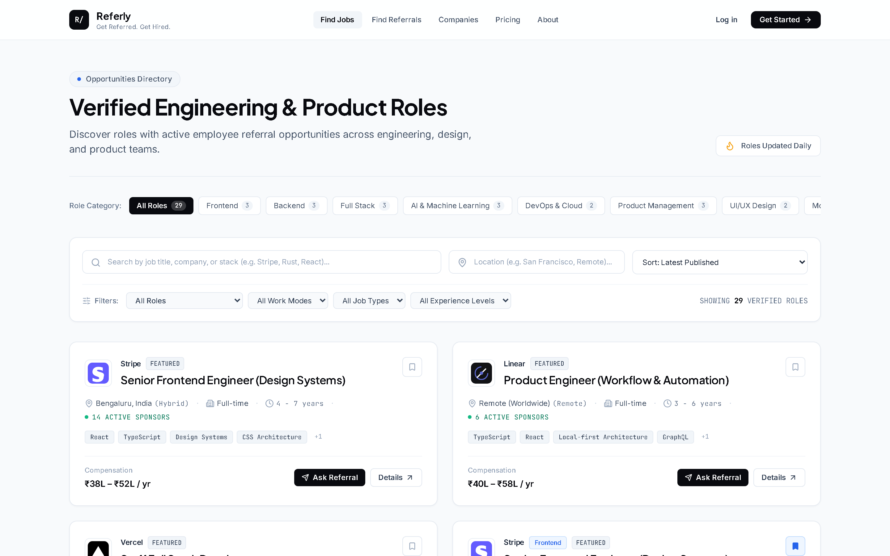 |

| Detailed Job View & Referrer Attributions | Active Referrers Directory |
| :---: | :---: |
| 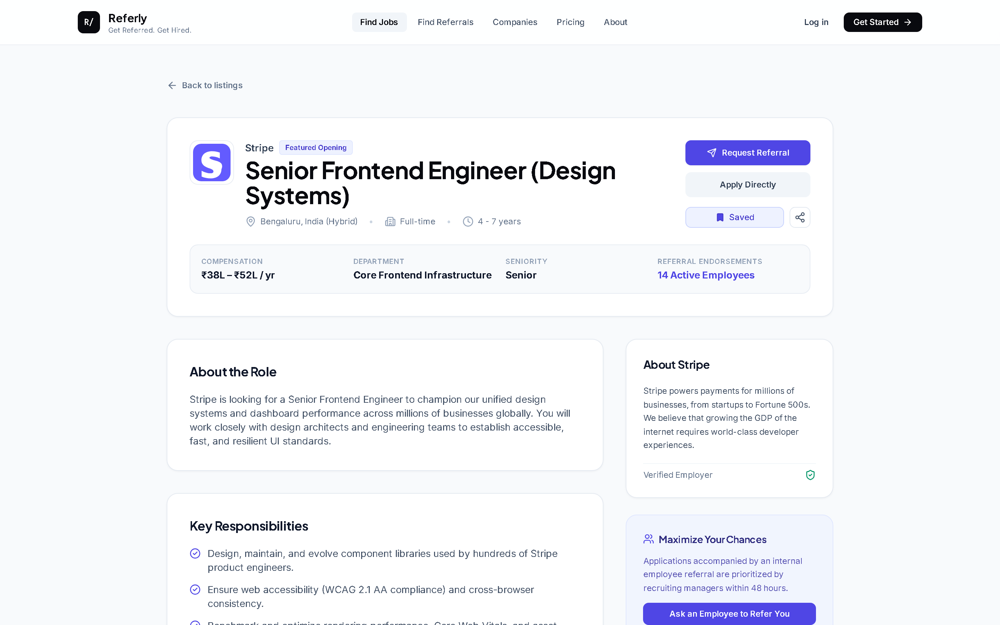 | 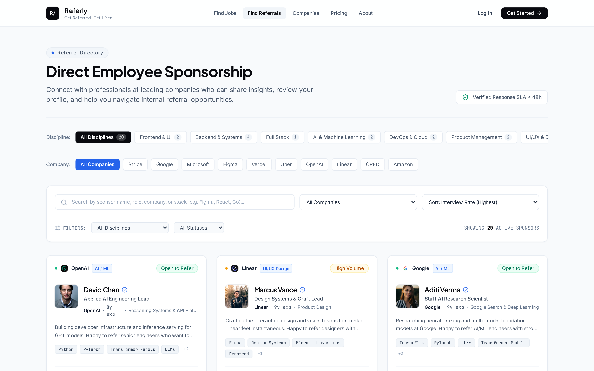 |

| Verified Company Profiles & Headcounts | Transparent Platform Pricing |
| :---: | :---: |
| 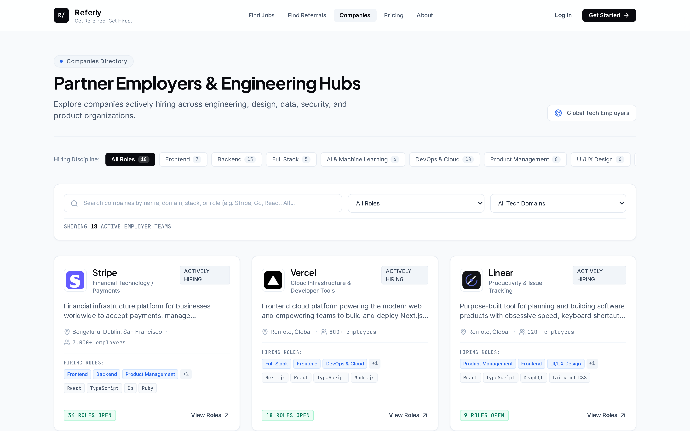 | 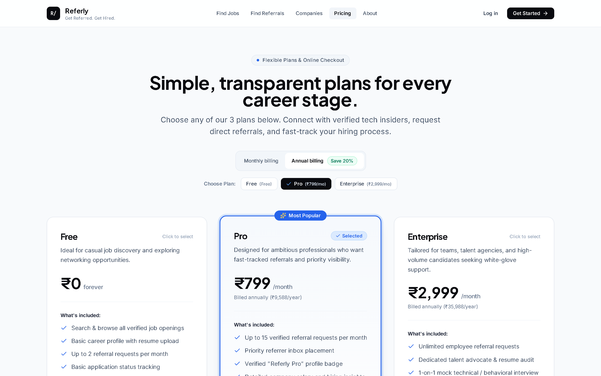 |

---

### Candidate (Job Seeker) Workflows

| Seeker Mission Control Dashboard | Real-Time Chat & Document Sharing |
| :---: | :---: |
| 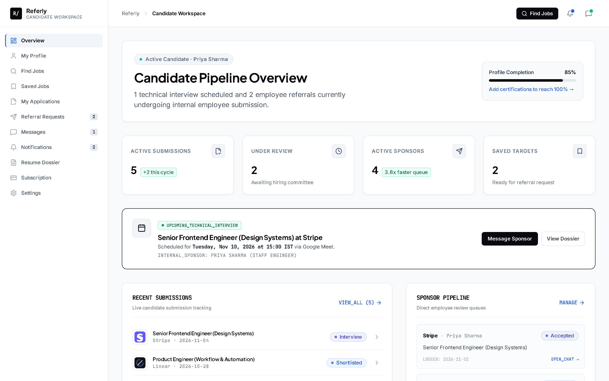 | 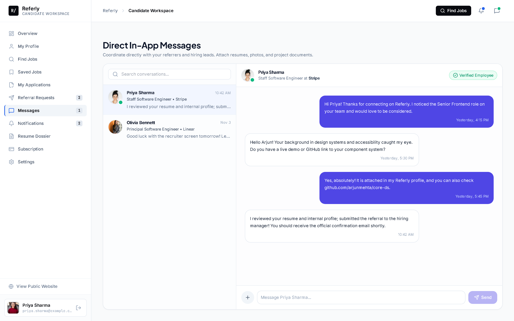 |

---

### Employee Sponsor (Referrer) Workflows

| Referrer Candidate Queue Dashboard | Professional Sponsor Profile Management |
| :---: | :---: |
| 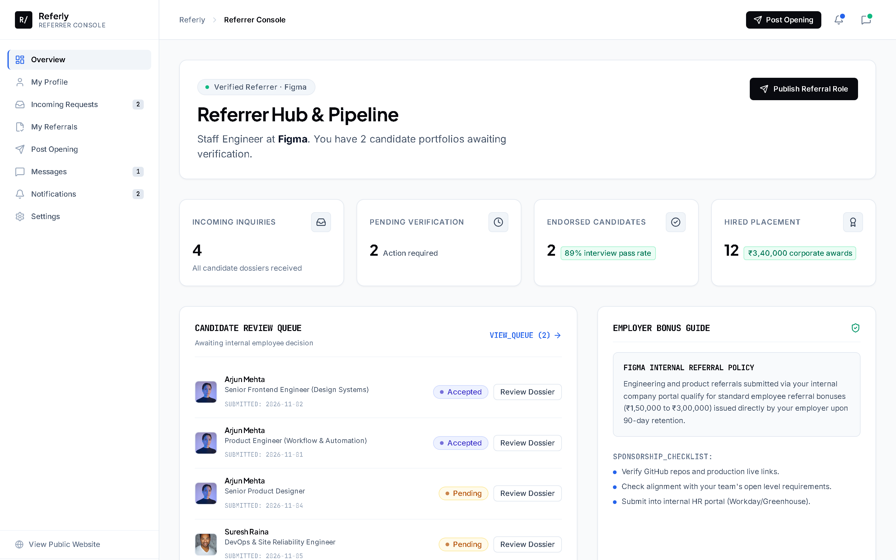 | 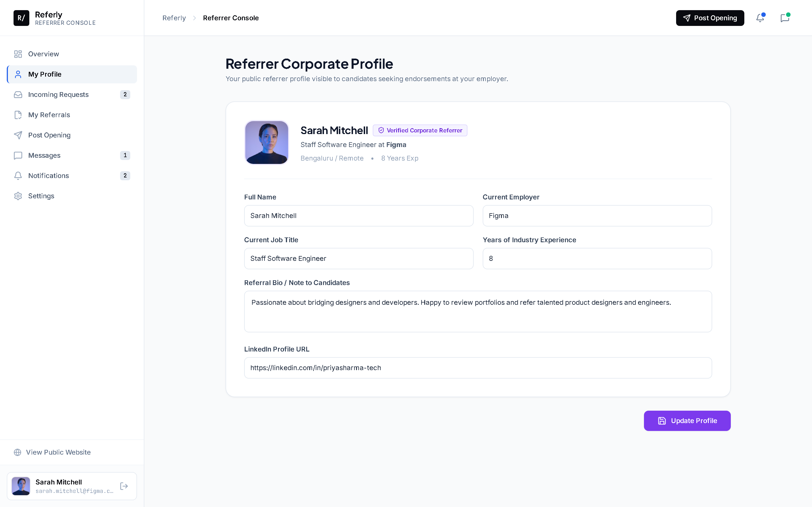 |

---

### Platform Administration

| Admin Mission Control & Telemetry | Authentication & Security Gate |
| :---: | :---: |
| 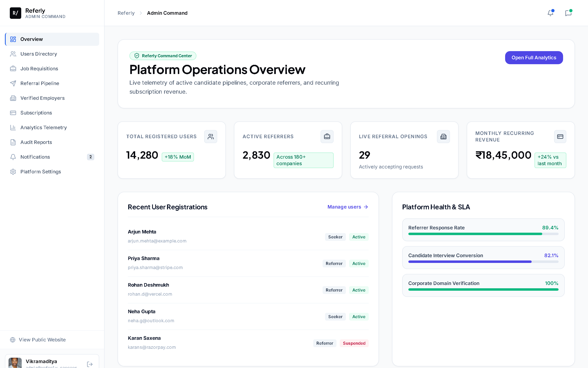 | 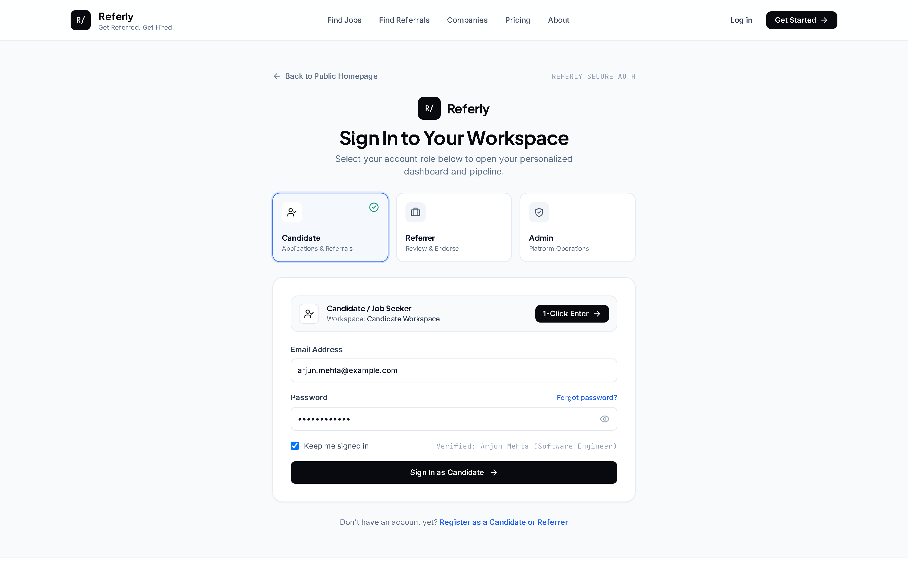 |

---

## 🚀 Key Features

### 👨‍💻 Candidate (Job Seeker) Features
- **Job Discovery & Multi-Vector Filtering:** Search 26+ pre-seeded tech positions by role specialization (Frontend, Backend, Fullstack, DevOps, Design, Product), arrangement (Remote, Hybrid, Onsite), and seniority.
- **Direct Employee Attribution:** Inspect which verified employees are actively sponsoring candidates for each requisition.
- **Structured Referral Requests:** Submit tailored notes, portfolio links, and target requisition codes directly to employee sponsors.
- **Resume & Profile Asset Management:** Upload and manage PDF resumes with green upload status indicators and file metadata.
- **Application Pipeline Tracker:** Follow applications through dynamic status stages (`Submitted` → `Under Review` → `Referred` → `Interview` → `Offer`).
- **Direct Messaging with Attachments:** Real-time messaging with sponsors supporting file explorer integration for resumes and design portfolios.
- **Saved Opportunities:** Bookmark positions to track openings or prepare customized pitches.

### 💼 Employee Sponsor (Referrer) Features
- **Verified Affiliation Badges:** Establish credibility with verified company tags (e.g., Stripe, Figma, Vercel, Linear, Google).
- **Inbound Referral Request Queue:** Review candidate pitches, portfolios, and attached resumes in a unified queue.
- **One-Click Decision Workflow:** Accept or decline referral requests with personalized guidance and internal ATS requisition codes.
- **Direct Candidate Dialogue:** Chat with prospective referrals to conduct informal screening and answer team questions.
- **Sponsorship Visibility Controls:** Toggle availability status (`Open to Refer` vs. `At Referral Capacity`).

### 🛡️ Platform Administrator Features
- **Mission Control Overview:** Live metrics on platform volume, active sponsors, conversion rates, and total requisitions.
- **Requisition & Company Moderation:** Curate, edit, or archive job postings and verify corporate domain records.
- **User & Role Governance:** Audit user credentials, handle disputes, and moderate network activity.
- **Interactive Swagger Documentation:** Built-in OpenAPI specification explorer available at `/api-docs`.

---

## 🏗️ System Architecture

Referly is architected as a modular TypeScript monorepo with clear separation between client presentation, API routing, business services, and database persistence.

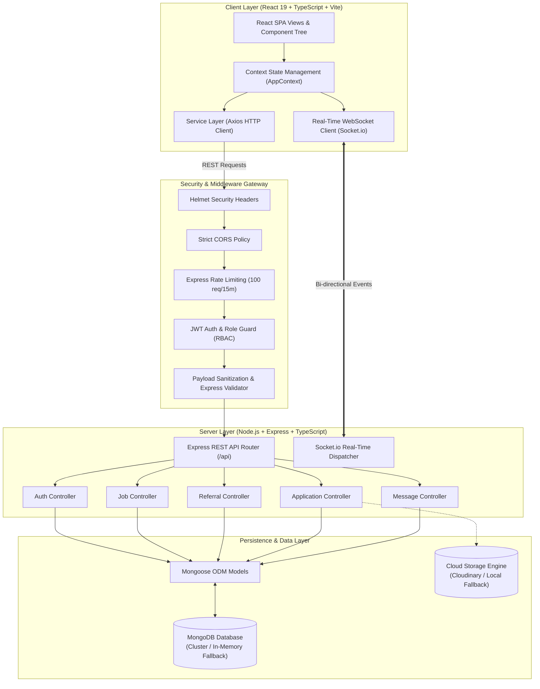

### ⚡ Dual-Mode Database Engine
Referly features zero-configuration developer onboarding:
1. **Production Cluster Mode:** Connects to any standard MongoDB cluster (MongoDB Atlas, AWS DocumentDB, local `mongod`).
2. **Automated In-Memory Fallback:** If `MONGODB_URI` is omitted or uncontactable, the backend automatically boots an in-process `mongodb-memory-server` and pre-populates all seed data, allowing reviewers and recruiters to clone and run the repository instantly.

---

## 💻 Tech Stack

| Domain | Technology | Purpose |
| :--- | :--- | :--- |
| **Frontend Framework** | [React 19](https://react.dev/) | Component architecture, state lifecycle, and fast rendering |
| **Frontend Tooling** | [Vite 8](https://vitejs.dev/) | Sub-millisecond HMR and optimized production asset bundling |
| **Language** | [TypeScript 5.8](https://www.typescriptlang.org/) | End-to-end type safety across both frontend and backend |
| **Styling & Icons** | [Tailwind CSS 3.4](https://tailwindcss.com/) + [Lucide React](https://lucide.dev/) | Clean utility styling and comprehensive vector iconography |
| **Routing** | [React Router v7](https://reactrouter.com/) | Declarative client-side routing with role-based layout boundaries |
| **Animation & Visuals** | [Framer Motion](https://www.framer.com/motion/) + [Canvas Confetti](https://www.npmjs.com/package/canvas-confetti) | Smooth route transitions and referral celebration effects |
| **Backend Framework** | [Express 4.21](https://expressjs.com/) | RESTful API endpoints and middleware orchestration |
| **Runtime** | [Node.js 22 LTS](https://nodejs.org/) | Scalable server runtime environment |
| **Database & ODM** | [MongoDB](https://www.mongodb.com/) + [Mongoose 8](https://mongoosejs.com/) | Schema-validated document persistence with in-memory fallback |
| **Authentication** | [JSON Web Tokens (JWT)](https://jwt.io/) + [bcryptjs](https://www.npmjs.com/package/bcryptjs) | Stateless dual-token authorization (1h Access / 7d Refresh) |
| **Real-Time Layer** | [Socket.io 4](https://socket.io/) | Low-latency bi-directional chat messaging and status updates |
| **Security Suite** | [Helmet](https://helmetjs.github.io/) + [Express Rate Limit](https://www.npmjs.com/package/express-rate-limit) | HTTP security headers and brute-force mitigation |
| **API Documentation** | [Swagger UI](https://swagger.io/tools/swagger-ui/) | Interactive OpenAPI specification hosted at `/api-docs` |
| **Testing** | [Jest](https://jestjs.io/) + [Supertest](https://www.npmjs.com/package/supertest) | Comprehensive backend unit and integration test suite |

---

## 📂 Project Folder Structure

```
Referly/
├── client/                     # Frontend React 19 + TypeScript Application
│   ├── public/
│   │   └── logos/              # High-fidelity SVG company logos (Stripe, Figma, etc.)
│   ├── src/
│   │   ├── assets/             # Brand graphics and illustrations
│   │   ├── components/         # Reusable UI component library
│   │   │   ├── auth/           # Login & registration modals
│   │   │   ├── common/         # Navbar, Footer, CompanyLogo, Badges, Modals
│   │   │   ├── dashboard/      # Role-specific dashboard widgets
│   │   │   ├── jobs/           # JobCard, JobFilters, ApplicationModal
│   │   │   ├── messaging/      # ChatContainer, MessageThread, AttachmentViewer
│   │   │   └── referrals/      # ReferrerCard, RequestModal, PipelineTracker
│   │   ├── context/            # AppContext (Auth state, live jobs, messages)
│   │   ├── data/               # 26+ verified jobs & 20+ referrer mock fallbacks
│   │   ├── layouts/            # PublicLayout, DashboardLayout, AdminLayout
│   │   ├── pages/              # Routed page components
│   │   ├── routes/             # AppRoutes.tsx with layout route boundaries
│   │   ├── services/           # Axios HTTP clients and Socket.io event bindings
│   │   ├── types/              # Canonical TypeScript interfaces (User, Job, etc.)
│   │   └── utils/              # Logo resolvers and text formatting utilities
│   ├── index.html              # HTML5 entrypoint with Referly branding
│   ├── tailwind.config.js      # Custom theme, typography, and palette configuration
│   ├── tsconfig.json           # Client TypeScript configuration
│   └── vite.config.ts          # Vite build and proxy settings
│
├── server/                     # Backend Node.js + Express Application
│   ├── src/
│   │   ├── config/             # Database, Cloudinary, and Swagger configuration
│   │   ├── controllers/        # Request handlers (Auth, Jobs, Referrals, Messages)
│   │   ├── middleware/         # Auth guards, role checks, and error handlers
│   │   ├── models/             # Mongoose schemas (User, Job, Referral, Application)
│   │   ├── routes/             # RESTful API route declarations
│   │   ├── services/           # Socket.io emitter and email dispatch logic
│   │   ├── utils/              # Database seeder and token utilities
│   │   └── server.ts           # Server entrypoint and graceful shutdown
│   ├── tests/                  # 18-suite Jest & Supertest integration suite
│   ├── tsconfig.json           # Server TypeScript configuration
│   └── package.json            # Server dependencies and scripts
│
├── docs/                       # Comprehensive Architecture & Technical Docs
│   ├── screenshots/            # Actual captured UI screenshots & project banner
│   ├── architecture/           # System design diagrams
│   ├── project-documentation/  # Extended functional specifications
│   ├── PROJECT_OVERVIEW.md     # Product mission, user personas, and roadmaps
│   ├── ARCHITECTURE.md         # Detailed architectural layers & security model
│   ├── SETUP_GUIDE.md          # Step-by-step installation & troubleshooting
│   ├── API_DOCUMENTATION.md    # REST endpoints, parameters, and payload schemas
│   └── DATABASE_DESIGN.md      # Data model, ERD diagram, and indexes
│
├── scripts/                    # Automation utilities (screenshot generator, logo scripts)
├── .env.example                # Safe environment variable template with zero secrets
├── .gitignore                  # Production monorepo git exclusion rules
├── LICENSE                     # MIT License
└── package.json                # Root orchestration scripts
```

---

## 🛠️ Installation & Setup

### Prerequisites
- **Node.js:** `v18.0.0` or higher (`v20.x` or `v22.x` LTS recommended)
- **npm:** `v9.0.0` or higher
- **Git:** Latest version

### 1. Clone the Repository
```bash
git clone https://github.com/ABHI180-hash/referly-job-referral-platform.git
cd referly-job-referral-platform
```

### 2. Install Dependencies
```bash
# Install root orchestration dependencies
npm install

# Install client dependencies
cd client && npm install

# Install server dependencies
cd ../server && npm install

# Return to root
cd ..
```

### 3. Configure Environment Variables
Copy the template to initialize your server environment:

```bash
# On macOS / Linux:
cp .env.example server/.env

# On Windows PowerShell:
Copy-Item .env.example server/.env
```

*(No modification is required to run locally — Referly automatically leverages its embedded in-memory database and pre-seeded dataset if no external MongoDB URI is set!)*

### 4. Start the Application
Run both frontend and backend concurrently from the root:

```bash
npm run dev
```

- **Frontend Application:** `http://localhost:5173`
- **Backend REST API:** `http://localhost:5000/api`
- **Interactive Swagger Docs:** `http://localhost:5000/api-docs`

---

## 🔑 Demo Accounts & Role Switching

Referly allows seamless role switching from the navigation bar. You can evaluate the platform using these pre-configured personas:

| Persona | Role | Default Name | Experience Focus |
| :--- | :--- | :--- | :--- |
| **Job Seeker** | `seeker` | Priya Sharma | Explore jobs, upload resumes, request referrals, track applications |
| **Referrer** | `referrer` | Sarah Mitchell | Manage incoming candidate requests, approve/decline referrals, chat |
| **Admin** | `admin` | Vikramaditya | Platform metrics, user governance, requisition moderation |

---

## 🔐 Environment Variables

The table below outlines all available environment variables (`.env.example`):

| Variable | Required | Default / Example | Purpose |
| :--- | :---: | :--- | :--- |
| `PORT` | Optional | `5000` | Port for the Express backend server |
| `NODE_ENV` | Optional | `development` | Environment mode (`development` / `production`) |
| `CLIENT_URL` | Optional | `http://localhost:5173` | Allowed origin for CORS validation |
| `MONGODB_URI` | Optional | `mongodb://localhost:27017/referly` | MongoDB URI (falls back to In-Memory if omitted) |
| `JWT_ACCESS_SECRET` | Required in Prod | `referly_dev_access_secret` | Secret key for signing 1-hour access JWTs |
| `JWT_REFRESH_SECRET`| Required in Prod | `referly_dev_refresh_secret` | Secret key for signing 7-day refresh JWTs |
| `JWT_ACCESS_EXPIRES_IN` | Optional | `1h` | Access token lifespan |
| `JWT_REFRESH_EXPIRES_IN`| Optional | `7d` | Refresh token lifespan |
| `CLOUDINARY_CLOUD_NAME` | Optional | `your_cloud_name` | Cloudinary asset cloud name |
| `CLOUDINARY_API_KEY` | Optional | `your_api_key` | Cloudinary API key |
| `CLOUDINARY_API_SECRET` | Optional | `your_api_secret` | Cloudinary API secret |
| `SMTP_HOST` | Optional | `smtp.mailtrap.io` | SMTP host for notification emails |
| `SMTP_PORT` | Optional | `2525` | SMTP port |
| `SMTP_USER` | Optional | `your_smtp_username` | SMTP username |
| `SMTP_PASSWORD` | Optional | `your_smtp_password` | SMTP password |
| `EMAIL_FROM` | Optional | `notifications@referly.careers` | Outbound email sender address |

---

## 📖 API Documentation

Referly's backend provides a RESTful API with full Swagger documentation accessible at `http://localhost:5000/api-docs`.

### Primary Endpoints Summary

| Method | Endpoint | Access | Description |
| :--- | :--- | :--- | :--- |
| `POST` | `/api/auth/register` | Public | Register new candidate or referrer account |
| `POST` | `/api/auth/login` | Public | Authenticate user and receive JWT tokens |
| `POST` | `/api/auth/refresh` | Public | Refresh expired access token |
| `GET` | `/api/jobs` | Public | Search and filter jobs with pagination |
| `GET` | `/api/jobs/:id` | Public | Retrieve detailed job requisition |
| `POST` | `/api/jobs` | Referrer / Admin | Post new job opening |
| `GET` | `/api/referrals` | Authenticated | Retrieve referral requests for current role |
| `POST` | `/api/referrals` | Seeker | Submit targeted referral request to an employee |
| `PATCH`| `/api/referrals/:id/status` | Referrer / Admin | Accept, reject, or mark referral as submitted |
| `GET` | `/api/messages/conversations`| Authenticated | List all active direct conversations |
| `POST` | `/api/messages/:id` | Authenticated | Send message with optional file attachments |
| `GET` | `/api/notifications` | Authenticated | Fetch unread platform alerts and updates |

*For complete request/response schemas, error codes, and query parameters, see [docs/API_DOCUMENTATION.md](docs/API_DOCUMENTATION.md).*

---

## 🧪 Testing & Verification

Referly includes automated unit, integration, and build verification suites.

### Run Backend Tests (Jest & Supertest)
```bash
cd server
npm test
```
*All 18 test suites execute against an isolated in-memory MongoDB instance, verifying authentication guards, rate limiters, token lifecycles, and role boundaries.*

### Verify Frontend Production Build
```bash
cd client
npm run build
```
*Executes TypeScript compiler (`tsc -b`) and bundles production assets via Vite.*

---

## 🤝 Contribution Guidelines

Contributions are welcomed! Follow these steps:

1. **Fork the Repository:** Create your personal fork on GitHub.
2. **Create a Feature Branch:**
   ```bash
   git checkout -b feature/enhanced-resume-parsing
   ```
3. **Commit Your Changes:** Follow conventional commit messages:
   ```bash
   git commit -m "feat(resume): integrate automated skill extraction parser"
   ```
4. **Push to Your Branch:**
   ```bash
   git push origin feature/enhanced-resume-parsing
   ```
5. **Open a Pull Request:** Describe your enhancements with testing notes and screenshots.

---

## 📄 License

This project is licensed under the **MIT License** — see the [LICENSE](LICENSE) file for details.

---

## 👤 Author & Acknowledgments

**Avijit Mandal**  
- **Email:** [am5084711@gmail.com](mailto:am5084711@gmail.com)  
- **Portfolio / Project:** Referly — Get Referred. Get Hired.  

*Special thanks to the open-source community for the tooling that made Referly possible: React, Vite, Tailwind CSS, Lucide Icons, Express, and Mongoose.*

<div align="center">
  <sub>Built with ❤️ for job seekers and career mentors worldwide.</sub>
</div>
