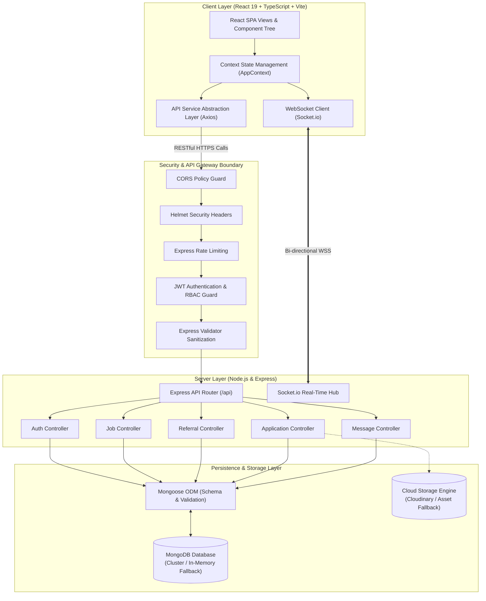

# Referly — System Architecture & Design Specification

This document details the architectural topology, component boundaries, state management patterns, security model, and data flow of the Referly platform.

---

## 1. High-Level Architecture Diagram



---

## 2. Frontend Architecture

The frontend is constructed as a modern Single Page Application (SPA) utilizing React 19, TypeScript, and Vite.

### 2.1 Core Technologies
- **UI Framework:** React 19 with functional components and React Hooks.
- **Language:** TypeScript 5.8+ enforcing end-to-end type safety across components, props, contexts, and API responses.
- **Styling Architecture:** Tailwind CSS v3 utility classes augmented by custom design system tokens (clean slate, subtle borders, accessible contrast ratios).
- **Icons & Assets:** Lucide React icons, verified brand SVG vector logos (`/public/logos/`).
- **Routing:** React Router v7 with modular route definitions, dynamic route parameters (`/jobs/:id`, `/referrers/:id`), and strict role-based layout guards.
- **State & Communication:** React Context API (`AppContext.tsx`) orchestrating client-side caching, active session tokens, real-time message feeds, and optimistic UI mutations.

### 2.2 Client-Side Directory Structure

```
client/src/
├── assets/          # Static images, illustrations, and styling resources
├── components/      # Reusable UI component hierarchy
│   ├── auth/        # Login, Register, RoleSelection modals
│   ├── common/      # Navbar, Footer, CompanyLogo, Badges, Modals, Toasts
│   ├── dashboard/   # Seeker, Referrer, and Admin dashboard widgets
│   ├── jobs/        # JobCard, JobFilters, ApplicationModal
│   ├── messaging/   # ChatContainer, MessageThread, AttachmentViewer
│   └── referrals/   # ReferrerCard, RequestModal, ReferralPipeline
├── context/         # Global AppContext and Session State Providers
├── data/            # Mock dataset fallbacks (26+ verified jobs, 20+ referrers)
├── layouts/         # PublicLayout, DashboardLayout, AdminLayout
├── pages/           # Routed application views
├── routes/          # AppRoutes.tsx with route boundaries
├── services/        # Axios API clients, Socket.io connections, Auth service
├── types/           # Canonical TypeScript interfaces (User, Job, Referral, etc.)
└── utils/           # Company logo matchers, formatters, sanitizers
```

---

## 3. Backend Architecture

The backend is built with Node.js and Express in TypeScript, structured with clear separation of concerns following the Controller-Service-Repository pattern.

### 3.1 Core Technologies
- **Runtime:** Node.js v22/26 LTS.
- **Framework:** Express v4.21.
- **Language:** TypeScript compiled to strict ES2022 JavaScript.
- **Object Data Modeling:** Mongoose v8.
- **Real-Time Engine:** Socket.io v4.
- **Documentation:** OpenAPI / Swagger UI served at `/api-docs`.

### 3.2 Dual-Mode Database Engine
A key resilience feature of Referly's backend is its adaptive database connectivity:
1. **Production Cluster Mode:** Connects to standard MongoDB clusters (e.g., MongoDB Atlas, local `mongod`) specified via `MONGODB_URI`.
2. **Zero-Config Evaluation Fallback:** If `MONGODB_URI` is absent or unreachable, the server automatically spins up an in-process `mongodb-memory-server` and pre-populates seed data. This allows instant setup, automated testing, and portfolio reviews without requiring external database provisioning.

### 3.3 Server Directory Structure

```
server/src/
├── config/          # Database, Cloudinary, and Swagger configuration
├── controllers/     # Request handlers and response orchestrators
│   ├── authController.ts
│   ├── jobController.ts
│   ├── referralController.ts
│   ├── applicationController.ts
│   ├── messageController.ts
│   ├── notificationController.ts
│   └── userController.ts
├── middleware/      # Security guards, JWT validation, error handlers
│   ├── auth.ts
│   ├── roleCheck.ts
│   ├── validate.ts
│   └── errorHandler.ts
├── models/          # Mongoose schema definitions and validation logic
│   ├── User.ts
│   ├── Job.ts
│   ├── Company.ts
│   ├── Referral.ts
│   ├── Application.ts
│   ├── Message.ts
│   └── Notification.ts
├── routes/          # Express route declarations with middleware binding
├── services/        # Business logic, email dispatch, socket emitters
├── utils/           # Seed generators, token helpers, logger
└── server.ts        # Server entrypoint and graceful shutdown hooks
```

---

## 4. Authentication & Security Model

### 4.1 Token Lifecycle
- **Access Tokens:** Signed with HMAC SHA-256 (`JWT_ACCESS_SECRET`), short-lived (1 hour), carrying minimal claims (`userId`, `role`, `email`).
- **Refresh Tokens:** Long-lived (7 days), signed with a distinct secret (`JWT_REFRESH_SECRET`), persisted to allow token revocation and silent session refreshes.
- **Password Protection:** Passwords salted and hashed with `bcryptjs` using a salt work factor of 12.

### 4.2 Route Guards & Role-Based Access Control (RBAC)
Every incoming request to protected routes passes through:
1. `authenticateToken`: Verifies the Bearer JWT in the `Authorization` header.
2. `requireRole(['seeker', 'referrer', 'admin'])`: Verifies that the authenticated subject possesses sufficient authorization privileges.

### 4.3 Network & API Hardening
- **Helmet:** Enforces HTTP strict transport security, DNS prefetch controls, and frameguard protections.
- **CORS:** Configured strictly to whitelist designated client origins (`CLIENT_URL`).
- **Rate Limiting:** IP-based sliding window rate limiter prevents brute-force credential stuffing and denial of service.
- **Input Validation:** Express-validator sanitizes and validates incoming JSON payloads before controller execution.

---

## 5. Real-Time Communication Protocol

Referly utilizes Socket.io for bidirectional communication:
- **Client Connection:** Authenticated handshake validating the user's JWT.
- **Room Isolation:** Users automatically join private channels (`user:${userId}`) and conversation channels (`conversation:${conversationId}`).
- **Event Dispatch:**
  - `message:sent`: Emitted when a candidate or referrer sends a chat message.
  - `message:received`: Instant push notification to the recipient socket.
  - `referral:status_updated`: Pushed to candidates when their referral request state changes.
  - `notification:new`: Platform-wide notification indicator update.
