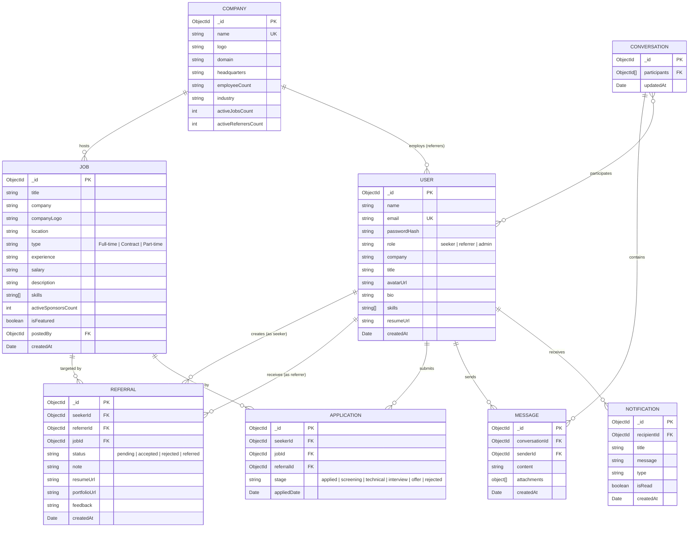

# Referly — Database Schema & Data Modeling

This document provides a detailed specification of Referly's data model, entity relationships, schema attributes, and indexing strategies using MongoDB and Mongoose.

---

## 1. Entity-Relationship Diagram (ERD)



---

## 2. Core Collections & Schema Specifications

### 2.1 Users Collection (`users`)
Stores profile information for all three user personas: candidates (`seeker`), employee sponsors (`referrer`), and administrators (`admin`).

| Field | Type | Required | Description |
| :--- | :--- | :--- | :--- |
| `_id` | `ObjectId` | Yes | Unique user identifier. |
| `name` | `String` | Yes | Full display name. |
| `email` | `String` | Yes | Unique login and communication email address. |
| `password` | `String` | Yes | Salted bcrypt password hash. |
| `role` | `String` | Yes | Enum: `['seeker', 'referrer', 'admin']`. |
| `company` | `String` | Conditional | Associated employer (mandatory for referrers). |
| `title` | `String` | No | Current job title or target specialization. |
| `avatar` | `String` | No | Profile photo URL. |
| `bio` | `String` | No | Professional summary or referral criteria. |
| `skills` | `[String]` | No | Primary technical skills and competencies. |
| `resumeUrl` | `String` | No | Stored resume link (PDF). |
| `resumeName` | `String` | No | Original uploaded filename. |
| `createdAt` | `Date` | Yes | Document creation timestamp. |

### 2.2 Jobs Collection (`jobs`)
Requisitions curated and open for referral requests.

| Field | Type | Required | Description |
| :--- | :--- | :--- | :--- |
| `_id` | `ObjectId` | Yes | Unique job identifier. |
| `title` | `String` | Yes | Position title (e.g. "Senior Frontend Engineer"). |
| `company` | `String` | Yes | Hiring company name. |
| `companyLogo` | `String` | Yes | Vector SVG logo path or asset URL. |
| `location` | `String` | Yes | City, State, Country, or "Remote". |
| `type` | `String` | Yes | Employment type: Full-time, Contract, etc. |
| `experience` | `String` | Yes | Seniority range (e.g. "4 - 7 years"). |
| `salary` | `String` | No | Compensation transparency range. |
| `skills` | `[String]` | Yes | Required tech stack tags. |
| `activeSponsorsCount` | `Number` | Yes | Number of verified employees open to refer. |
| `isFeatured` | `Boolean` | No | Featured spotlight toggle. |

### 2.3 Referrals Collection (`referrals`)
The central transaction record tracking an endorsement request from a candidate to an employee.

| Field | Type | Required | Description |
| :--- | :--- | :--- | :--- |
| `_id` | `ObjectId` | Yes | Unique referral transaction identifier. |
| `seeker` | `ObjectId` | Yes | Reference to candidate User document. |
| `referrer` | `ObjectId` | Yes | Reference to sponsor User document. |
| `job` | `ObjectId` | Yes | Reference to Job document. |
| `status` | `String` | Yes | `['pending', 'accepted', 'rejected', 'referred']`. |
| `note` | `String` | Yes | Candidate's personalized pitch to the referrer. |
| `resumeUrl` | `String` | No | Attached resume document URL. |
| `feedback` | `String` | No | Optional feedback or requisition confirmation note. |

---

## 3. Database Indexing Strategy

To guarantee rapid queries under high read volumes, the following indexes are maintained:

```javascript
// Unique email constraint
db.users.createIndex({ email: 1 }, { unique: true });

// Job search and filter acceleration
db.jobs.createIndex({ title: "text", company: "text", skills: "text" });
db.jobs.createIndex({ location: 1, type: 1, experience: 1 });
db.jobs.createIndex({ createdAt: -1 });

// Referral lookup by candidate and sponsor
db.referrals.createIndex({ seeker: 1, createdAt: -1 });
db.referrals.createIndex({ referrer: 1, status: 1 });
db.referrals.createIndex({ job: 1 });

// Real-time chat history
db.messages.createIndex({ conversation: 1, createdAt: 1 });
```
