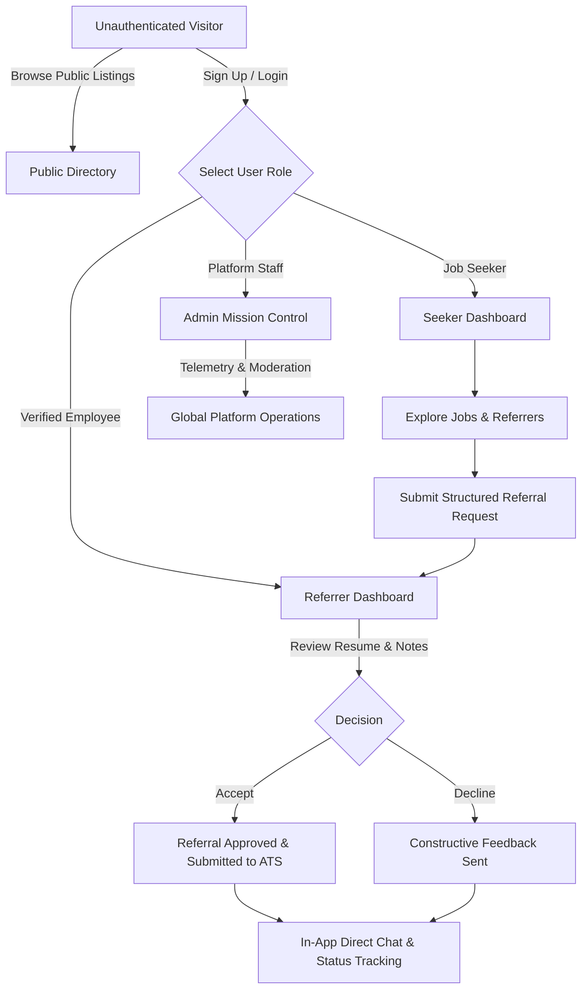

# Referly — Project Overview

> **"Get Referred. Get Hired."**  
> *A Modern Full-Stack Job Referral & Career Networking Platform*

---

## 1. Executive Summary

Referly is an enterprise-grade job referral and talent networking web platform engineered to bridge the gap between ambitious job seekers and employee advocates inside leading tech organizations. In the contemporary technology job market, traditional cold applications frequently disappear into automated applicant tracking systems (ATS), yielding conversion rates below 2%. Internal referrals, conversely, boast interview rates exceeding 40% and faster hiring velocity.

Referly institutionalizes and streamlines this referral dynamic. It transforms the informal, fragmented referral hunting process into a structured, transparent, and mutually beneficial career marketplace where verified employees can sponsor talent, candidates can showcase verified accomplishments, and platform administrators maintain high marketplace integrity.

---

## 2. Problem Statement

### The Candidate Dilemma
- **ATS Black Hole:** Hundreds of generic applications submitted through standard job boards often go unread due to keyword filtering and sheer volume.
- **Cold Outreach Fatigue:** Candidates spend hours messaging engineers and hiring managers on social networks with near-zero response rates due to misaligned incentives and spam.
- **Lack of Tracking & Feedback:** Candidates rarely receive actionable status updates on whether their referral was actually submitted or forwarded to hiring managers.

### The Referrer Dilemma
- **Unvetted Inbound Requests:** Industry professionals regularly receive generic messages asking for referrals without resumes, specific target roles, or contextual proof of ability.
- **Time Investment:** Managing resumes across email, LinkedIn messages, and internal HR tools creates friction and overhead.
- **Compliance & Security:** Employees fear endorsing unverified candidates or sharing sensitive internal job requisition codes.

### The Platform Solution
Referly introduces a unified, role-aware workflow that:
1. Provides curated, role-matched job requisitions with verified active internal referrers.
2. Imposes a structured referral application protocol requiring tailored notes, role targeting, and verified resume attachments.
3. Empowers employee referrers with a streamlined candidate management dashboard to accept, review, or decline requests in seconds.
4. Provides real-time status pipelines and direct in-app messaging with attachment support to ensure total transparency.

---

## 3. Target User Personas

| Persona | Primary Goal | Core Workflows |
| :--- | :--- | :--- |
| **Job Seeker (Candidate)** | Discover high-impact tech opportunities, secure internal employee referrals, and track applications to offer stage. | • Browse & filter 26+ curated jobs by role, location, and seniority. • Submit structured referral requests with customized pitches. • Manage resume assets and chat directly with sponsors. • Monitor dynamic pipeline status (Submitted → In Review → Accepted → Referred). |
| **Referrer (Employee Sponsor)** | Sponsor qualified talent into their organization and discover peers matching team hiring needs. | • Showcase verified corporate affiliation (e.g. Stripe, Linear, Vercel, Google). • Review inbound referral requests with attached resumes and profiles. • Accept or decline referrals with feedback. • Direct chat with candidates to clarify qualifications. |
| **Platform Administrator** | Maintain platform health, curate job listings, verify company domains, and analyze telemetry. | • Moderate job listings, company profiles, and user credentials. • Oversee platform analytics (conversion rates, active referrers, open positions). • Manage platform subscriptions and resolve flagged interactions. |

---

## 4. Key Platform Features

### 4.1 Intelligent Job & Sponsor Discovery
- **Multi-Vector Filtering:** Filter opportunities by title, engineering specialty (Frontend, Backend, Fullstack, DevOps, Design, Product, AI/ML), employment arrangement (Remote, Hybrid, Onsite), and experience tier.
- **Direct Sponsor Attribution:** Every job card showcases verified referrers actively championing candidates for that specific requisition.
- **Company Catalog:** Browse deep corporate profiles with active headcount counts, culture highlights, tech stacks, and dedicated referral pools.

### 4.2 Streamlined Referral Lifecycle
- **Structured Request Modal:** Candidates submit targeted referral pitches including target role link, years of experience, portfolio link, and attached resume.
- **Sponsor Decision Queue:** Referrers receive instant notifications and can accept or decline requests with personalized feedback.
- **Real-Time Visual Pipeline:** Interactive kanban and timeline trackers update candidates the moment their status shifts.

### 4.3 Real-Time Communications & Document Sharing
- **In-App Messaging Suite:** Low-latency bi-directional messaging powered by Socket.io.
- **Attachment Support:** Native file explorer integration allowing candidates and referrers to exchange resumes (PDF), code samples, and portfolio screenshots with upload status indicators.

### 4.4 Enterprise-Grade Security & Reliability
- **Multi-Tier Role-Based Access Control (RBAC):** Strict route guards for Seeker, Referrer, and Admin roles.
- **Defensive Storage Engine:** Zero-dependency MongoDB Memory Server fallback for instant offline evaluation and self-hosted environments.
- **JWT Double-Token Authentication:** Secure short-lived access tokens paired with revocable refresh tokens.

---

## 5. High-Level User Journey

---

## 6. Project Roadmap

- [x] **v1.0 (Current):** Full-stack MERN monorepo with 3 user roles, job exploration, referrer directory, referral pipeline, resume upload, live chat, admin moderation, and dual-mode database engine.
- [ ] **v1.1:** OAuth2 single sign-on via Google, GitHub, and LinkedIn.
- [ ] **v1.2:** Native ATS webhook integration (Greenhouse, Lever, Ashby).
- [ ] **v1.3:** AI-powered resume vs. job description match-scoring engine.
